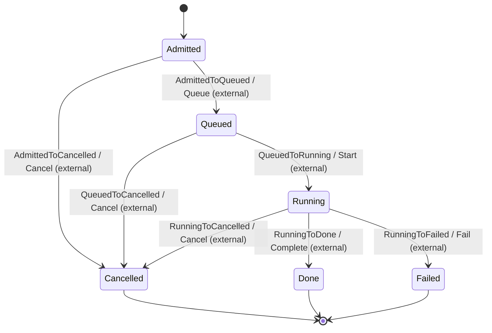
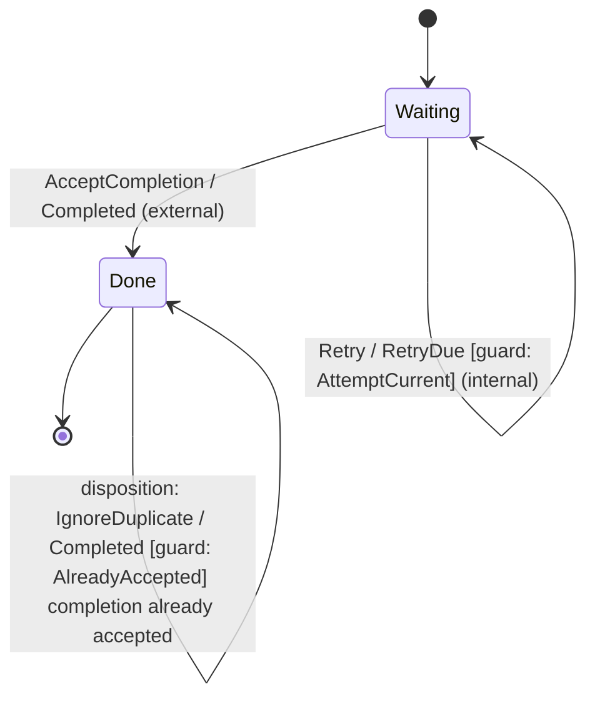

# Generated state-machine diagrams

These Mermaid blocks are generated from validated Rust machine definitions.
GitHub renders them directly when viewing this Markdown file.

Regenerate from the repository root:

```sh
cargo run --quiet --package state-machine --example diagrams > crates/state-machine/docs/diagrams.md
```

The `generated_diagrams` test checks this file against the generator.
[Generator source](../examples/diagrams/model.rs) uses the convenience identity
family for readable labels; custom families can use enums and `DiagramLabels`.
Layout is chosen by GitHub's Mermaid renderer. These examples do not require
a particular Mermaid version or layout engine.

## EKGF execution lifecycle

Six states and seven permitted routes, based on the
EKGF execution lifecycle model.
Event identities are explicit example choices. Initial state is Admitted;
Done, Failed and Cancelled are terminal.



## Retry and duplicate completion

A small illustrative machine shows a guarded internal self-transition, an
accepted completion and an explicit harmless duplicate-completion disposition.
Its unit payloads and constant predicates illustrate graph structure; a real
consumer supplies attempt correlation and policy facts.



