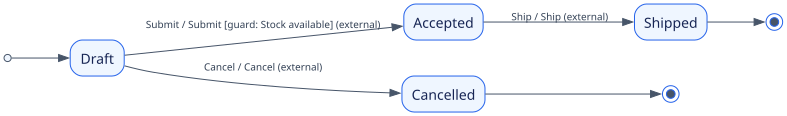

# Executable state-machine tutorials

Run these from the repository root. Both examples use enum state/event identities,
caller-owned instance IDs and explicit data/fact types. Labels are only diagram
presentation, never identifier conversion.

| Example | What to observe | Source |
| --- | --- | --- |
| `cargo run --example typed_order` | A stock guard refuses without mutation; acceptance returns confirmation work and an invoice output, without executing either. A destination invariant also prevents zero-quantity acceptance. | [runner](../../examples/typed_order.rs), [definition](../../examples/tutorials/order.rs) |
| `cargo run --example checkout` | One declared route connects separate order and invoice instances. Explicit propagation budgets permit two transitions; the caller receives both effects after releasing exclusive bindings. | [runner](../../examples/checkout.rs), [composition](../../examples/tutorials/checkout.rs) |

## Guarded order



Draft submission requires the caller's stock fact. An isolated action records the
request; Accepted requires positive quantity. Success returns
`SendConfirmation` and emits `InvoiceRequested`. Shipping returns `DispatchParcel`.
Cancelling is allowed while Draft. Refusal or an invalid candidate changes
nothing. Shipped and Cancelled are terminal.

## Invoice and explicit composition


The caller maps the order's invoice output to the invoice's input using a `Route`.
The invoice records the order ID and returns `SendInvoice`. It has independent
state/data/revision; propagation is not a distributed transaction. Earlier
accepted transitions survive later failure, and step/intent limits return
unprocessed deliveries. No callback performs I/O; the caller executes returned
work after dropping the exclusive binding.

The [Mermaid versions](diagrams.md) render directly on GitHub. The same SVGs and
explanations appear in the crate's Rustdoc landing page after its next release.
The [shared domain types](../../examples/tutorials/model.rs) demonstrate
`MachineIds`, explicit `CandidateData` isolation and separate diagram labels.

## Regeneration and tests

```sh
python3 scripts/render_tutorial_diagrams.py
cargo test --test tutorials --test tutorial_diagrams
cargo run --example typed_order
cargo run --example checkout
cargo doc --no-deps
```

Regeneration uses the installed Graphviz `dot` command for layout. It reads the
canonical Mermaid emitted by the executable definitions and refuses syntax it
does not understand. Graphviz is a documentation development tool, not a crate
runtime dependency. Layout output can differ between Graphviz versions; the
regression checks the definition source embedded in each SVG rather than
requiring one platform's coordinates. All SVGs ship inside the crate and are
inlined into Rustdoc, with accessible titles/descriptions and no JavaScript.
