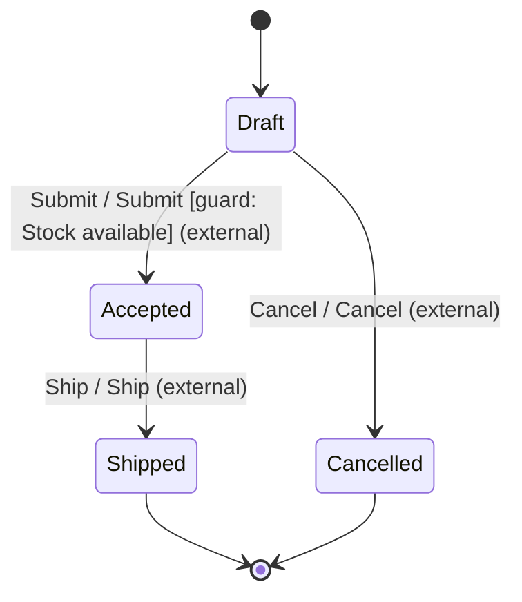
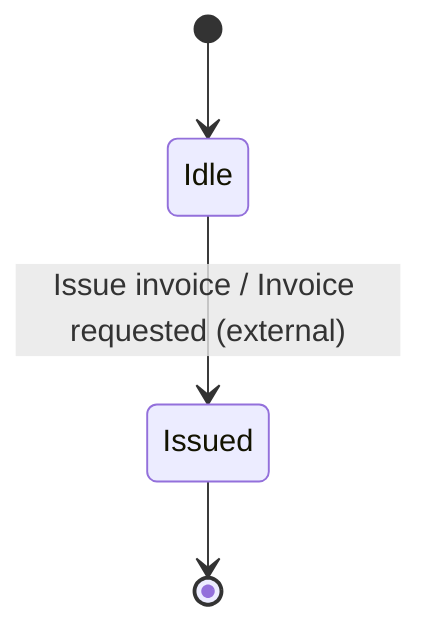

# Executable tutorial diagrams

These graphs are generated from the same definitions used by the runnable
[typed order](../../examples/typed_order.rs) and
[composed checkout](../../examples/checkout.rs) tutorials.
See the [tutorial guide](README.md) for the execution and ownership contracts.

## Guarded order

## Invoice

