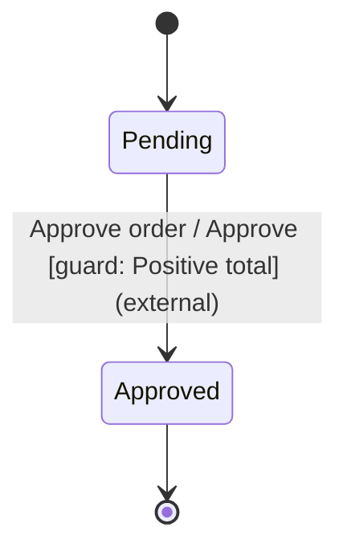

# Status Machina for Node.js

Native JavaScript objects, TypeScript declarations, enum/symbol identities and
exceptions for caller-driven state machines. The transition kernel is shared
with the Rust and Python packages. Evaluation is synchronous; applications own
I/O, clocks, scheduling and external effect execution.

Development is in progress. This package has not been published yet.

The current implementation supports checked definitions, dispatch, isolated
snapshots, single-use decisions, exact callback causes and explicit disposal.
Full model parity, installed artifacts and the platform/release matrix remain
under development; see the repository's binding design.

Capabilities are synchronous advisory policies over detached data and facts.
The native instance identity and `bigint` revision accompany every report:

```typescript
import { CapabilityStatus, type Capability } from '@legra-ai/status-machina';

const edit = Symbol('edit');
const editable: Capability<Phase, Document, CallerFacts> = {
  id: edit,
  evaluate: (state, data, facts) => state === Phase.Open && facts.canEdit
    ? CapabilityStatus.Available : CapabilityStatus.Unavailable,
};
// Include capabilities: [editable] when constructing the Definition.
const report = machine.evaluateCapability(edit, callerFacts);
```

Policies can return `Available`, `Unavailable` or `Unknown`. Exceptions retain
the original JavaScript error as `CallbackError.cause`; they never become denial
results. A policy may use an exact `BehaviorRef` to an EKGF Story implementation.
Enum members, symbols and object identities remain independent of their labels.
Reports describe an observation and never grant authorization.

## Portable records and identity codecs

A `DefinitionRecord` is a data-only graph: native identities and exact
`BehaviorRef` selections, with no functions, module specifiers or string codec.
Bind it against an explicit `BehaviorRegistry`; the Rust kernel's
`DefinitionRecord::bind` resolves every use site and applies the ordinary
builder rules. Binding runs no callback and never loads code.

```typescript
import { BehaviorUse, DefinitionRecord, PredicateRecord, StateRecord,
  TransitionDefinitionRecord } from '@legra-ai/status-machina';

const record = new DefinitionRecord<Phase, Input>({
  id: invoiceGraph, initial: Phase.Draft,
  states: [new StateRecord({ id: Phase.Draft }), new StateRecord({ id: Phase.Sent, terminal: true })],
  transitions: [new TransitionDefinitionRecord({
    id: sendEdge, source: Phase.Draft, event: Input.Send, target: Phase.Sent,
    guard: new PredicateRecord(new BehaviorUse(hasLinesUse, hasLinesV1)),
    actions: [new BehaviorUse(stampUse, stampV1)],
  })],
});
const definition = record.bind<Invoice>(registry);   // Definition<Phase, Input, Invoice>
```

Condition records are `PredicateRecord`, `AllRecord`, `AnyRecord` and
`NotRecord`, a union discriminated by `kind`; `DispositionRecord` declares a
harmless event. Records are frozen class instances and reject functions, plain
objects and unknown fields when constructed. Binding failures are `RecordError`
subclasses whose `context` holds native identities: `UnknownBehaviorError`
(`story`), `UnknownImplementationError` (`story`, `implementation`) and
`RoleMismatchError` (`expected`/`actual` `BehaviorRole`) are `BindingError`s;
`ConditionRecordError`, `TransitionRecordError` and `DispositionRecordError` name
the invalid record, and graph rules such as unreachable states name the
`state`/`transition`.

`new IdentityMap({ role: IdentityRole.State, entries, maxEntries })` is the
kernel `IdentityMap` for one role: an explicit, bounded (1..4096), one-to-one
codec between native identities and caller-owned representations such as IRIs.
Identities follow `Map` semantics, so object tokens compare by identity and
nothing is stringified. `new MachineIdentityMaps({ state, event, ... })` holds
at most one codec per role and rejects a codec of another role, at compile time
and at run time; `encode`/`decode` are typed by the configured role. Failures
are `IdentityMapError` subclasses: `DuplicateIdentityError` and
`DuplicateRepresentationError` (with the offending `entry`),
`UnknownIdentityError`, `UnknownRepresentationError`, `IdentityMapLimitError`
and `IdentityRoleError`. Codecs are uncloneable, like definitions. Runtime
matching never consults a codec; decode external names before building records
and encode outcomes afterwards.

## Compose machines

A `Composition` routes the outputs of registered machines to other registered
machines. The Rust kernel's `InstanceRegistry`, `Composition` and
`BoundComposition` decide every rule; JavaScript only lowers native values. The
[runnable composition example](examples/composition.mjs) gives one order identity
an address in three routing scopes and propagates a payment through all three:

```js
const [sales, warehouse, finance] = ['sales', 'warehouse', 'finance'].map(scope => new InstanceAddress(scope, 'order-7'));
const composition = new Composition({
  sources: new InstanceRegistry({ entries: [[sales, order], [warehouse, shipment]] }),
  destinations: new InstanceRegistry({ entries: [[warehouse, shipment], [finance, invoice]] }),
  routes: [new Route({ source: sales, event: Paid, destination: warehouse, inputEvent: Pack }),
    new Route({ source: warehouse, event: Packed, destination: finance, inputEvent: Issue })],
});
const bound = composition.bind([[sales, order], [warehouse, shipment], [finance, invoice]]);
const report = bound.propagate([new Delivery(sales, { kind: Pay, payload: { order: 'order-7', amount: 120 } })],
  { limits: new PropagationLimits({ maxSteps: 8, maxIntents: 8 }) });
bound.dispose();
// The binding is released: execute effects now, outside any machine operation.
for (const effect of report.effects) console.log(`${effect.source.scope} effect: ${effect.intent.payload}`);
```

It prints:

```text
sales: OPEN -> PAID
warehouse: WAITING -> PACKED
finance: DRAFT -> ISSUED
warehouse effect: label for order-7
quiescent {"total":120}
```

- `new InstanceAddress(scope, instance)` compares each component with `Map`
  semantics (`address.equals(other)`), so equal instance identities in different
  scopes are different addresses and object tokens compare by identity. A
  registered address must name its machine's `id`.
- `new Route({ source, event, destination, inputEvent, capability })` maps one
  source output event to one destination input event. With a capability, the
  route defers unless a `composition.capabilities({ revisions, reports })`
  snapshot observes it `available` at the destination's current revision.
  Reports must come from `machine.evaluateCapability`; they are advisory.
- `composition.routeBatch(source, outputs)` returns ordered items discriminated
  by `kind` (`routed`, `unmatched`, `deferred`) and dispatches nothing.
  Unmatched and deferred items keep the original output intent object.
- `composition.bind(entries)` takes exclusive use of every registered machine,
  like a Rust `&mut` borrow: until `dispose()` (or `using`), the machines throw
  `BusyError` for direct operations. `propagate` dispatches in FIFO order in
  the caller's stack, within explicit `PropagationLimits` (1..4096 each).

Composition is not a distributed transaction. A `PropagationReport` keeps every
accepted step, the addressed effects they returned, unrouted outputs and the
`pending` deliveries. When a later step fails, `status` is `dispatch_failed` and
`error` is the typed exception with the original `cause`; earlier steps stay
accepted and the failed delivery leads `pending`, ready to propagate again.
`step_limit`, `intent_limit` and `unbound_destination` stop the same way. Caller
inputs come back in `pending` as the original `Delivery` objects. TypeScript
narrows `report.error` to `DispatchError` on `status === 'dispatch_failed'`.

Rejections are `CompositionError` subclasses carrying the kernel `reason` in
`context`: `InstanceRegistryError` (`AddressMismatchError`,
`DuplicateInstanceError`, `InstanceRegistryLimitError`) with the `registry`,
`entry`, `address` and `machine`; `CompositionDefinitionError`
(`DuplicateRouteError`, `UnregisteredRouteAddressError`,
`UndeclaredRouteEventError`, `UndeclaredCapabilityError`,
`CompositionLimitError`) with the native `route`; `RouteBatchError`
(`UnregisteredSourceError`, `BatchLimitError`) with every `outputs` item;
`CompositionBindingError` (`DuplicateBindingError`, `UnregisteredBindingError`,
`BindingMismatchError`, `MissingBindingError`, `AliasedBindingError`);
`PropagationLimitsError`; and `CapabilitySnapshotError`
(`ReportInstanceMismatchError`, `DuplicateObservationError`,
`CapabilitySnapshotLimitError`, `ForeignSnapshotError`). Compositions,
snapshots and bindings are uncloneable, like machines.

## Inspect and draw a definition

The [runnable Node.js order example](examples/order.mjs) checks an approval transition
and generates the following diagram through `Definition.diagram()`:



`Definition.structuralCoverage()` reports declared states, transitions and harmless-event
dispositions, including incoming/outgoing edge counts. Reports retain native
identifiers in insertion order. They describe graph structure, not proof that
an edge can execute or has been tested. Inspection does not run guards, actions,
invariants or effect constructors.

Diagram labels are explicit maps from identifiers to text. Two states with the
same label remain different nodes. Missing/non-string labels fail instead of
converting enums, symbols or objects to strings; unused roles may be omitted.
The Rust renderer escapes Mermaid punctuation and enforces the output budget.

Inspection defaults to 4096 combined state/transition/disposition entries and
1 MiB UTF-8 output. The native APIs permit at most 1000000 entries and 1 MiB
output. The byte bound also limits label preparation, and includes escaped text
and Mermaid syntax in the final diagram. Invalid limits, missing labels and
exceeded bounds raise `InspectionError`; the violated budget is in its context.

Pass `{ maxEntries, maxOutputBytes }` to either inspection method. Diagram label
roles are `states`, `transitions`, `events`, `conditions` and `dispositions`, each
a native `Map`. Coverage objects, arrays and rows are frozen; TypeScript retains
the definition's state/event types.

## Worker threads

Each `Definition`, `Machine` and `Decision` belongs to the Node environment and
thread that created it, and its callbacks run only there. Every worker builds its
own definitions and machines; they run independently of those of other threads.
Passing one to `postMessage` or `workerData`, even nested inside another value,
throws the platform's `DataCloneError` instead of cloning an empty object. Send
domain data and rebuild the definition in the receiving worker. Terminating a
worker releases the machines and decisions it still holds, including during a
callback. This needs `worker_threads.markAsUncloneable`, so the package requires
Node.js 22.10 or newer.

The planned macOS target is macOS 26 on ARM64, tested on `macos-latest`.
Intel macOS is outside the native package support matrix.

## Develop from source

Building from source needs the Rust toolchain pinned in `rust-toolchain.toml`.
From this directory:

```sh
pnpm install --frozen-lockfile
pnpm build      # compile the native addon
pnpm test       # CommonJS and ESM suites
pnpm typecheck  # declarations and the typing fixtures in tests/typing
```

CI runs these commands on Linux, macOS and Windows with Node.js 22 and 24.
