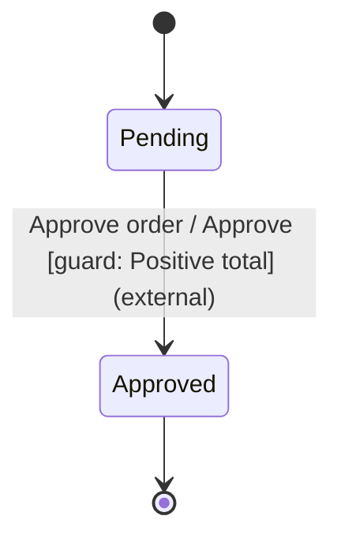

# Status Machina for Node.js

Native JavaScript objects, TypeScript declarations, enum/symbol identities and
exceptions for caller-driven state machines. The transition kernel is shared
with the Rust and Python packages. Evaluation is synchronous; applications own
I/O, clocks, scheduling and external effect execution.

Development is in progress. This package has not been published yet.

The current implementation supports checked definitions, dispatch, isolated
snapshots, single-use decisions, exact callback causes and explicit disposal.
Full model parity, installed artifacts and the platform/release matrix remain
under development; see the repository's binding design.

Capabilities are synchronous advisory policies over detached data and facts.
The native instance identity and `bigint` revision accompany every report:

```typescript
import { CapabilityStatus, type Capability } from '@legra-ai/status-machina';

const edit = Symbol('edit');
const editable: Capability<Phase, Document, CallerFacts> = {
  id: edit,
  evaluate: (state, data, facts) => state === Phase.Open && facts.canEdit
    ? CapabilityStatus.Available : CapabilityStatus.Unavailable,
};
// Include capabilities: [editable] when constructing the Definition.
const report = machine.evaluateCapability(edit, callerFacts);
```

Policies can return `Available`, `Unavailable` or `Unknown`. Exceptions retain
the original JavaScript error as `CallbackError.cause`; they never become denial
results. A policy may use an exact `BehaviorRef` to an EKGF Story implementation.
Enum members, symbols and object identities remain independent of their labels.
Reports describe an observation and never grant authorization.

## Portable records and identity codecs

A `DefinitionRecord` is a data-only graph: native identities and exact
`BehaviorRef` selections, with no functions, module specifiers or string codec.
Bind it against an explicit `BehaviorRegistry`; the Rust kernel's
`DefinitionRecord::bind` resolves every use site and applies the ordinary
builder rules. Binding runs no callback and never loads code.

```typescript
import { BehaviorUse, DefinitionRecord, PredicateRecord, StateRecord,
  TransitionDefinitionRecord } from '@legra-ai/status-machina';

const record = new DefinitionRecord<Phase, Input>({
  id: invoiceGraph, initial: Phase.Draft,
  states: [new StateRecord({ id: Phase.Draft }), new StateRecord({ id: Phase.Sent, terminal: true })],
  transitions: [new TransitionDefinitionRecord({
    id: sendEdge, source: Phase.Draft, event: Input.Send, target: Phase.Sent,
    guard: new PredicateRecord(new BehaviorUse(hasLinesUse, hasLinesV1)),
    actions: [new BehaviorUse(stampUse, stampV1)],
  })],
});
const definition = record.bind<Invoice>(registry);   // Definition<Phase, Input, Invoice>
```

Condition records are `PredicateRecord`, `AllRecord`, `AnyRecord` and
`NotRecord`, a union discriminated by `kind`; `DispositionRecord` declares a
harmless event. Records are frozen class instances and reject functions, plain
objects and unknown fields when constructed. Binding failures are `RecordError`
subclasses whose `context` holds native identities: `UnknownBehaviorError`
(`story`), `UnknownImplementationError` (`story`, `implementation`) and
`RoleMismatchError` (`expected`/`actual` `BehaviorRole`) are `BindingError`s;
`ConditionRecordError`, `TransitionRecordError` and `DispositionRecordError` name
the invalid record, and graph rules such as unreachable states name the
`state`/`transition`.

`new IdentityMap({ role: IdentityRole.State, entries, maxEntries })` is the
kernel `IdentityMap` for one role: an explicit, bounded (1..4096), one-to-one
codec between native identities and caller-owned representations such as IRIs.
Identities follow `Map` semantics, so object tokens compare by identity and
nothing is stringified. `new MachineIdentityMaps({ state, event, ... })` holds
at most one codec per role and rejects a codec of another role, at compile time
and at run time; `encode`/`decode` are typed by the configured role. Failures
are `IdentityMapError` subclasses: `DuplicateIdentityError` and
`DuplicateRepresentationError` (with the offending `entry`),
`UnknownIdentityError`, `UnknownRepresentationError`, `IdentityMapLimitError`
and `IdentityRoleError`. Codecs are uncloneable, like definitions. Runtime
matching never consults a codec; decode external names before building records
and encode outcomes afterwards.

## Compose machines

A `Composition` routes the outputs of registered machines to other registered
machines. The Rust kernel's `InstanceRegistry`, `Composition` and
`BoundComposition` decide every rule; JavaScript only lowers native values. The
[runnable composition example](examples/composition.mjs) gives one order identity
an address in three routing scopes and propagates a payment through all three:

```js
const [sales, warehouse, finance] = ['sales', 'warehouse', 'finance'].map(scope => new InstanceAddress(scope, 'order-7'));
const composition = new Composition({
  sources: new InstanceRegistry({ entries: [[sales, order], [warehouse, shipment]] }),
  destinations: new InstanceRegistry({ entries: [[warehouse, shipment], [finance, invoice]] }),
  routes: [new Route({ source: sales, event: Paid, destination: warehouse, inputEvent: Pack }),
    new Route({ source: warehouse, event: Packed, destination: finance, inputEvent: Issue })],
});
const bound = composition.bind([[sales, order], [warehouse, shipment], [finance, invoice]]);
const report = bound.propagate([new Delivery(sales, { kind: Pay, payload: { order: 'order-7', amount: 120 } })],
  { limits: new PropagationLimits({ maxSteps: 8, maxIntents: 8 }) });
bound.dispose();
// The binding is released: execute effects now, outside any machine operation.
for (const effect of report.effects) console.log(`${effect.source.scope} effect: ${effect.intent.payload}`);
```

It prints:

```text
sales: OPEN -> PAID
warehouse: WAITING -> PACKED
finance: DRAFT -> ISSUED
warehouse effect: label for order-7
quiescent {"total":120}
```

- `new InstanceAddress(scope, instance)` compares each component with `Map`
  semantics (`address.equals(other)`), so equal instance identities in different
  scopes are different addresses and object tokens compare by identity. A
  registered address must name its machine's `id`.
- `new Route({ source, event, destination, inputEvent, capability })` maps one
  source output event to one destination input event. With a capability, the
  route defers unless a `composition.capabilities({ revisions, reports })`
  snapshot observes it `available` at the destination's current revision.
  Reports must come from `machine.evaluateCapability`; they are advisory.
- `composition.routeBatch(source, outputs)` returns ordered items discriminated
  by `kind` (`routed`, `unmatched`, `deferred`) and dispatches nothing.
  Unmatched and deferred items keep the original output intent object.
- `composition.bind(entries)` takes exclusive use of every registered machine,
  like a Rust `&mut` borrow: until `dispose()` (or `using`), the machines throw
  `BusyError` for direct operations. `propagate` dispatches in FIFO order in
  the caller's stack, within explicit `PropagationLimits` (1..4096 each).

Composition is not a distributed transaction. A `PropagationReport` keeps every
accepted step, the addressed effects they returned, unrouted outputs and the
`pending` deliveries. When a later step fails, `status` is `dispatch_failed` and
`error` is the typed exception with the original `cause`; earlier steps stay
accepted and the failed delivery leads `pending`, ready to propagate again.
`step_limit`, `intent_limit` and `unbound_destination` stop the same way. Caller
inputs come back in `pending` as the original `Delivery` objects. TypeScript
narrows `report.error` to `DispatchError` on `status === 'dispatch_failed'`.

Rejections are `CompositionError` subclasses carrying the kernel `reason` in
`context`: `InstanceRegistryError` (`AddressMismatchError`,
`DuplicateInstanceError`, `InstanceRegistryLimitError`) with the `registry`,
`entry`, `address` and `machine`; `CompositionDefinitionError`
(`DuplicateRouteError`, `UnregisteredRouteAddressError`,
`UndeclaredRouteEventError`, `UndeclaredCapabilityError`,
`CompositionLimitError`) with the native `route`; `RouteBatchError`
(`UnregisteredSourceError`, `BatchLimitError`) with every `outputs` item;
`CompositionBindingError` (`DuplicateBindingError`, `UnregisteredBindingError`,
`BindingMismatchError`, `MissingBindingError`, `AliasedBindingError`);
`PropagationLimitsError`; and `CapabilitySnapshotError`
(`ReportInstanceMismatchError`, `DuplicateObservationError`,
`CapabilitySnapshotLimitError`, `ForeignSnapshotError`). Compositions,
snapshots and bindings are uncloneable, like machines.

## Retry and correlated waits

`RetryPolicy` decides when to retry and `RetryWaits` records which wake a
machine accepts. The Rust kernel's `RetryPolicy` and `RetryWaits` decide every
rule; JavaScript only lowers native values. Durations are `Duration` values
(exact BigInt nanoseconds over the range of Rust's `Duration`) and instants are
`Date` values. The caller supplies every count, elapsed duration, deadline and
current time, and owns the scheduler: nothing here reads a clock, starts a timer
or schedules a wake. The [runnable retry example](examples/retry.mjs) backs off
exponentially and delivers every wake twice:

```js
const policy = new RetryPolicy({ delay: new ExponentialBackoff({ initial: Duration.ofHours(1), maximum: Duration.ofHours(4) }),
  maxAttempts: 5, maxElapsed: Duration.ofDays(1) });
// In the 'retry' transition's action:
data.failures += 1;
const { delay } = policy.schedule(data.failures, clock.elapsed);
data.waits.schedule('fetch', delay.after(clock.now), `timer-${data.failures}`);
// In the 'wake' transition, guarded by data.waits.isDue(correlation, clock.now):
data.waits.consume(correlation, clock.now);
data.attempts += 1;
```

It prints:

```text
wait timer-1 until 10:00
wake: transitioned
duplicate: ignored
wait timer-2 until 12:00
wake: transitioned
duplicate: ignored
attempts: 3
```

- `Duration.from({ hours: 6, minutes: 30 })`, `Duration.ofSeconds(10)` and the
  other factories take safe integers or BigInts; `Duration.ZERO` and
  `Duration.MAX` bound the range. `duration.after(date)` adds it to a `Date`,
  rounded up to the millisecond so a deadline is never early.
- `new RetryPolicy({ delay, maxAttempts, maxElapsed })` takes a `FixedDelay` or
  an `ExponentialBackoff({ initial, maximum })`. `maxAttempts` counts every
  attempt, the first included. `maxElapsed` is required: a `Duration` bounds the
  time since the first attempt, and `null` explicitly states an indefinite
  window; the attempt bound still holds. `schedule(failedAttempts, elapsed)`
  returns a `RetryAt` (`delay`) or a `RetryExhausted`, discriminated by `kind`.
  Doubling saturates at the cap, and an elapsed sum beyond `Duration.MAX`
  exhausts.
- `new RetryWaits({ instance, capacity })` (1..4096) is ordinary machine data.
  Schedule and consume from candidate actions, so a refused transition keeps the
  accepted waits; a `WaitCapacityReachedError` thrown by `schedule` refuses the
  whole transition. The default snapshot copies the kernel waits and payloads
  and keeps the identities; a custom snapshot function calls
  `waits.clone(copyPayload)`. Retry values are uncloneable or immutable.
- `schedule(operation, deadline, payload)` returns a `WaitCorrelation`
  (`instance`, `operation`, BigInt `generation`); scheduling the same operation
  again replaces its wait with a new generation. `pending()` lists waits whose
  registration is not yet acknowledged by `markRegistered(correlation)`.
  `isDue` and `consume(correlation, now)` match only the exact current wait,
  with `Map` semantics: an early, stale, replaced, cancelled, foreign or
  duplicate wake returns `false`/`undefined`, so it never counts as an attempt.
  Generations are never reused. A correlation is a value: rebuild it with
  `new WaitCorrelation({ instance, operation, generation })` after a round trip
  through a scheduler.

Errors are `RetryError` subclasses carrying the kernel `reason` in `context`:
`RetryPolicyError` (`ZeroDelayError`, `TooFewAttemptsError`,
`CapBelowInitialError`), `RetryWaitError` (`InvalidWaitCapacityError`,
`WaitCapacityReachedError`, `WaitGenerationExhaustedError`) and
`RetryRangeError` for a value outside its kernel type: a negative or oversized
duration, an attempt count outside 0..2**32-1, a generation outside
0..2**64-1, a `Date` sum beyond its range or an instant the platform's
`SystemTime` cannot hold. Its `context` names the `field` and holds the `value`.

## Replay scenarios against safety assertions

`ScenarioReplay.run` replays explicit, finite scenarios on fresh instances of one
definition and checks independent safety assertions after every step. The Rust
kernel's `ScenarioLimits`, `ScenarioSet`, `ScenarioAssertion` and
`ScenarioReplay` decide every limit, set bound, assertion order, dispatch,
budget and trace rule; JavaScript only interns identities, with `Map`
semantics, and resolves the report. The
[runnable scenario example](examples/scenarios.mjs) finds the transition that
ships an unpaid order:

```js
const neverShipsUnpaid = new ScenarioAssertion({ id: 'never-ships-unpaid',
  evaluate: step => !(step.before === Phase.Cart && step.after === Phase.Shipped) });

function run(...scenarios) {
  const { result } = ScenarioReplay.run(definition, { id: 'replay', data: { paid: [] },
    scenarios: new ScenarioSet({ scenarios, limits: new ScenarioLimits({ maxStepsPerScenario: 8 }) }),
    assertions: [neverShipsUnpaid] });
```

It prints:

```text
complete within 1 scenarios, 2 steps
counterexample to never-ships-unpaid in rush:
  0: RUSH CART -> SHIPPED
```

- `new ScenarioLimits({ maxScenarios, maxStepsPerScenario, maxNodes,
  maxOutputs, maxTraceEntries })` defaults to the kernel's 64, 256, 4096, 4096
  and 4096; the ceilings are 1024, 4096, 65536, 65536 and 65536.
- `new ScenarioSet({ scenarios, limits })` holds `{ id, steps }` scenarios, each
  step an `{ event: { kind, payload }, facts }` object. It reads iterables
  lazily, at most one entry past a bound, so an endless generator fails with its
  bound. Scenario identities are any values; two scenarios may share one.
- `new ScenarioAssertion({ id, evaluate })` takes a synchronous predicate that
  returns `true` while the property holds, or an exact `BehaviorRef` to an
  `assertion` implementation in the definition's `BehaviorRegistry`. Assertions
  run in order; at most 128 are accepted. Like every callback they must be pure,
  total and bounded, which the binding cannot prove.
- Each scenario starts from a snapshot of `data`; the caller's object is never
  mutated. Each step performs exactly one dispatch. Output events are counted
  and discarded, never dispatched, and effects are never executed.
- A frozen observation holds the `scenario` identity, the zero-based `step`,
  the `inputEvent` kind, the states `before` and `after`, the `outcome`
  (`{ kind: 'transitioned', transition }`, `{ kind: 'ignored', disposition }`,
  `{ kind: 'refused' }` or `{ kind: 'dispatch_failed' }`) and the produced
  `outputEvents` and `effects` identities. It never holds payloads or machine
  data.
- `report.result` is discriminated by `kind`: `complete_within_scenarios`
  (`scenarios`, `nodes`), the coverage of exactly the supplied scenarios and
  steps and not a proof over other inputs; `counterexample`, whose `trace` names
  the scenario, the failing assertion and the step prefix through the failing
  step; `limit_reached` (`scenario`, `step`, `limit`: a `ScenarioLimit`); or
  `execution_failed` (`scenario`, `step`, `failure`: a `ScenarioFailure`,
  `steps`). Step 0 with no steps means the initial data failed, or raised in,
  the initial state's invariant.
- Every distinct input value occupies one value slot of the definition's
  `limits.maxValues` for the whole replay; repeated values share their slot.

A thrown guard, action, constructor, snapshot or assertion stops replay with
`CallbackError` (`SnapshotError` for snapshots) whose `phase` names the stage
and whose `cause` is the original exception. Rejections are `ScenarioError`
subclasses carrying the kernel `reason`: `ScenarioLimitsError`;
`ScenarioSetError` (`EmptyScenarioSetError`, `ScenarioCountLimitError`,
`ScenarioStepLimitError`, `ScenarioNodeLimitError`), whose `context` names the
refused `scenario` and its `entry` position; `ScenarioAssertionError`
(`MissingAssertionPredicateError`); and `ScenarioReplayError`
(`AssertionLimitError`). An assertion reference that does not resolve throws
`UnknownBehaviorError`, `UnknownImplementationError` or `RoleMismatchError`
naming the `assertion` and its `entry`.

## Inspect and draw a definition

The [runnable Node.js order example](examples/order.mjs) checks an approval transition
and generates the following diagram through `Definition.diagram()`:



`Definition.structuralCoverage()` reports declared states, transitions and harmless-event
dispositions, including incoming/outgoing edge counts. Reports retain native
identifiers in insertion order. They describe graph structure, not proof that
an edge can execute or has been tested. Inspection does not run guards, actions,
invariants or effect constructors.

Diagram labels are explicit maps from identifiers to text. Two states with the
same label remain different nodes. Missing/non-string labels fail instead of
converting enums, symbols or objects to strings; unused roles may be omitted.
The Rust renderer escapes Mermaid punctuation and enforces the output budget.

Inspection defaults to 4096 combined state/transition/disposition entries and
1 MiB UTF-8 output. The native APIs permit at most 1000000 entries and 1 MiB
output. The byte bound also limits label preparation, and includes escaped text
and Mermaid syntax in the final diagram. Invalid limits, missing labels and
exceeded bounds raise `InspectionError`; the violated budget is in its context.

Pass `{ maxEntries, maxOutputBytes }` to either inspection method. Diagram label
roles are `states`, `transitions`, `events`, `conditions` and `dispositions`, each
a native `Map`. Coverage objects, arrays and rows are frozen; TypeScript retains
the definition's state/event types.

## Worker threads

Each `Definition`, `Machine` and `Decision` belongs to the Node environment and
thread that created it, and its callbacks run only there. Every worker builds its
own definitions and machines; they run independently of those of other threads.
Passing one to `postMessage` or `workerData`, even nested inside another value,
throws the platform's `DataCloneError` instead of cloning an empty object. Send
domain data and rebuild the definition in the receiving worker. Terminating a
worker releases the machines and decisions it still holds, including during a
callback. This needs `worker_threads.markAsUncloneable`, so the package requires
Node.js 22.10 or newer.

The planned macOS target is macOS 26 on ARM64, tested on `macos-latest`.
Intel macOS is outside the native package support matrix.

## Develop from source

Building from source needs the Rust toolchain pinned in `rust-toolchain.toml`.
From this directory:

```sh
pnpm install --frozen-lockfile
pnpm build      # compile the native addon
pnpm test       # CommonJS and ESM suites
pnpm typecheck  # declarations and the typing fixtures in tests/typing
```

CI runs these commands on Linux, macOS and Windows with Node.js 22 and 24.
