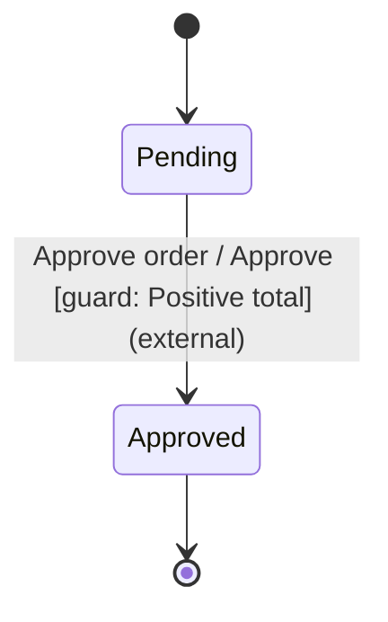

# Status Machina for Node.js

Native JavaScript objects, TypeScript declarations, enum/symbol identities and
exceptions for caller-driven state machines. The transition kernel is shared
with the Rust and Python packages. Evaluation is synchronous; applications own
I/O, clocks, scheduling and external effect execution.

Development is in progress. This package has not been published yet.

The current implementation supports checked definitions, dispatch, isolated
snapshots, single-use decisions, exact callback causes and explicit disposal.
Full model parity, installed artifacts and the platform/release matrix remain
under development; see the repository's binding design.

Capabilities are synchronous advisory policies over detached data and facts.
The native instance identity and `bigint` revision accompany every report:

```typescript
import { CapabilityStatus, type Capability } from '@legra-ai/status-machina';

const edit = Symbol('edit');
const editable: Capability<Phase, Document, CallerFacts> = {
  id: edit,
  evaluate: (state, data, facts) => state === Phase.Open && facts.canEdit
    ? CapabilityStatus.Available : CapabilityStatus.Unavailable,
};
// Include capabilities: [editable] when constructing the Definition.
const report = machine.evaluateCapability(edit, callerFacts);
```

Policies can return `Available`, `Unavailable` or `Unknown`. Exceptions retain
the original JavaScript error as `CallbackError.cause`; they never become denial
results. A policy may use an exact `BehaviorRef` to an EKGF Story implementation.
Enum members, symbols and object identities remain independent of their labels.
Reports describe an observation and never grant authorization.

## Inspect and draw a definition

The [runnable Node.js order example](examples/order.mjs) checks an approval transition
and generates the following diagram through `Definition.diagram()`:



`Definition.structuralCoverage()` reports declared states, transitions and harmless-event
dispositions, including incoming/outgoing edge counts. Reports retain native
identifiers in insertion order. They describe graph structure, not proof that
an edge can execute or has been tested. Inspection does not run guards, actions,
invariants or effect constructors.

Diagram labels are explicit maps from identifiers to text. Two states with the
same label remain different nodes. Missing/non-string labels fail instead of
converting enums, symbols or objects to strings; unused roles may be omitted.
The Rust renderer escapes Mermaid punctuation and enforces the output budget.

Inspection defaults to 4096 combined state/transition/disposition entries and
1 MiB UTF-8 output. The native APIs permit at most 1000000 entries and 1 MiB
output. The byte bound also limits label preparation, and includes escaped text
and Mermaid syntax in the final diagram. Invalid limits, missing labels and
exceeded bounds raise `InspectionError`; the violated budget is in its context.

Pass `{ maxEntries, maxOutputBytes }` to either inspection method. Diagram label
roles are `states`, `transitions`, `events`, `conditions` and `dispositions`, each
a native `Map`. Coverage objects, arrays and rows are frozen; TypeScript retains
the definition's state/event types.

The planned macOS target is macOS 26 on ARM64, tested on `macos-latest`.
Intel macOS is outside the native package support matrix.

## Develop from source

Building from source needs the Rust toolchain pinned in `rust-toolchain.toml`.
From this directory:

```sh
pnpm install --frozen-lockfile
pnpm build      # compile the native addon
pnpm test       # CommonJS and ESM suites
pnpm typecheck  # declarations and the typing fixtures in tests/typing
```

CI runs these commands on Linux, macOS and Windows with Node.js 22 and 24.
