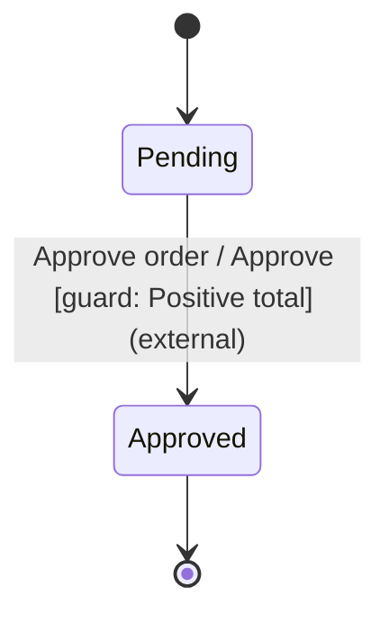

# Status Machina for Python

Native enums, dataclasses and exceptions for caller-driven state machines.
The transition kernel is shared with Status Machina's Rust and Node.js packages.

Development is in progress. This package has not been published yet.

Capabilities are advisory policies, evaluated synchronously against detached
current data and caller facts. They return `CapabilityStatus.AVAILABLE`,
`UNAVAILABLE` or `UNKNOWN`; a raised exception is a `CallbackError` with its
original `__cause__`, never an unavailable result.

```python
from status_machina import Capability, CapabilityStatus

# Policy.EDIT and Phase.OPEN are members of application-owned Enum classes.
editable = Capability(
    Policy.EDIT,
    lambda state, data, facts: (
        CapabilityStatus.AVAILABLE if state is Phase.OPEN and facts.can_edit
        else CapabilityStatus.UNAVAILABLE
    ),
)
# Include capabilities=(editable,) when constructing the Definition.
report = machine.evaluate_capability(Policy.EDIT, facts=caller_facts)
assert report.instance is machine.id
assert report.revision == machine.revision
```

Reports describe one observation; applications retain authorization authority.
A capability may also use an exact `BehaviorRef` to a registered EKGF Story
implementation. Its identifier, Story and implementation may all be native enums
or other hashable domain identities, independently of display labels.

## Portable records and identity codecs

A `DefinitionRecord` is a data-only graph: native identities and exact
`BehaviorRef` selections, with no callables, module paths or string codec. Bind
it against an explicit `BehaviorRegistry`; the Rust kernel's
`DefinitionRecord::bind` resolves every use site and applies the ordinary
builder rules. Binding runs no callback and never loads code.

```python
from status_machina import (
    BehaviorUse, DefinitionRecord, PredicateRecord, StateRecord, TransitionDefinitionRecord,
)

record = DefinitionRecord(
    id=InvoiceGraph.V1, initial=Phase.DRAFT,
    states=(StateRecord(Phase.DRAFT), StateRecord(Phase.SENT, terminal=True)),
    transitions=(TransitionDefinitionRecord(
        Edge.SEND, Phase.DRAFT, Input.SEND, Phase.SENT,
        guard=PredicateRecord(BehaviorUse(Use.HAS_LINES, has_lines_v1)),
        actions=(BehaviorUse(Use.STAMP, stamp_v1),),
    ),),
)
definition = record.bind(registry)   # Definition[Phase, Input, Any]
assert definition.record is record
```

Condition records are `PredicateRecord`, `AllRecord`, `AnyRecord` and
`NotRecord`, discriminated by `kind`; `DispositionRecord` declares a harmless
event. Records reject callables and foreign values when constructed. Binding
failures are `RecordError` subclasses whose `context` holds native identities:
`UnknownBehaviorError` (`story`), `UnknownImplementationError` (`story`,
`implementation`) and `RoleMismatchError` (`expected`/`actual` `BehaviorRole`)
are `BindingError`s; `ConditionRecordError`, `TransitionRecordError` and
`DispositionRecordError` name the invalid record, and graph rules such as
unreachable states name the `state`/`transition`.

`IdentityMap(IdentityRole.STATE, entries, max_entries=4096)` is the kernel
`IdentityMap` for one role: an explicit, bounded, one-to-one codec between
native identities and caller-owned representations such as IRIs. Keys include
their concrete type, so `1`, `True` and members of different `IntEnum` classes
never alias, and nothing is derived from `str` or `repr`. `MachineIdentityMaps`
holds at most one codec per `IdentityRole` field and rejects a codec of another
role. Failures are `IdentityMapError` subclasses: `DuplicateIdentityError` and
`DuplicateRepresentationError` (with the offending `entry`),
`UnknownIdentityError`/`UnknownRepresentationError` (also `LookupError`),
`IdentityMapLimitError` (also `LimitError`) and `IdentityRoleError`. Runtime
matching never consults a codec; decode external names before building records
and encode outcomes afterwards.

## Inspect and draw a definition

The [runnable Python order example](examples/order.py) checks an approval transition
and generates the following diagram through `Definition.diagram()`:



`Definition.structural_coverage()` reports declared states, transitions and harmless-event
dispositions, including incoming/outgoing edge counts. Reports retain native
identifiers in insertion order. They describe graph structure, not proof that
an edge can execute or has been tested. Inspection does not run guards, actions,
invariants or effect constructors.

Diagram labels are explicit maps from identifiers to text. Two states with the
same label remain different nodes. Missing/non-string labels fail instead of
converting enums, symbols or objects to strings; unused roles may be omitted.
The Rust renderer escapes Mermaid punctuation and enforces the output budget.

Inspection defaults to 4096 combined state/transition/disposition entries and
1 MiB UTF-8 output. The native APIs permit at most 1000000 entries and 1 MiB
output. The byte bound also limits label preparation, and includes escaped text
and Mermaid syntax in the final diagram. Invalid limits, missing labels and
exceeded bounds raise `InspectionError`; the violated budget is in its context.

Pass `limits=InspectionLimits(max_entries=..., max_output_bytes=...)` to either
inspection method. Use `DiagramLabels(states=..., transitions=..., events=...,
conditions=..., dispositions=...)` for the rendered roles.

The planned macOS target is macOS 26 on ARM64, tested on `macos-latest`.
Intel macOS is outside the native package support matrix.

## Develop from source

Building from source needs the Rust toolchain pinned in `rust-toolchain.toml`.
From this directory:

```sh
uv sync --locked                 # environment, dev tools and the native module
uv run --locked maturin develop  # rebuild the module after Rust changes
uv run --locked python -m unittest discover -s tests -v
uv run --locked mypy             # source and static typing contracts
```

The dev group installs `uv` into the environment. `maturin develop` installs
with that copy, so an older `uv` on `PATH` cannot break the rebuild. CI runs
these commands on Linux, macOS and Windows with Python 3.10 and 3.14.
