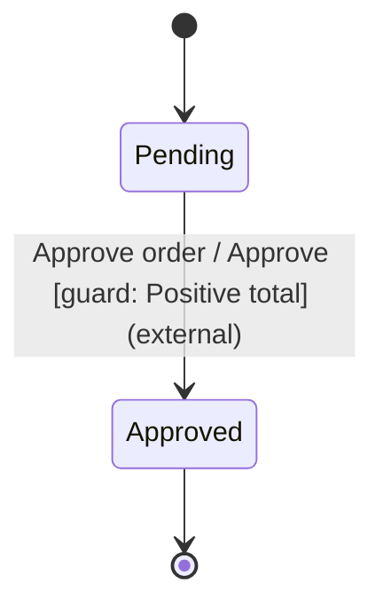

# Status Machina for Python

Native enums, dataclasses and exceptions for caller-driven state machines.
The transition kernel is shared with Status Machina's Rust and Node.js packages.

Development is in progress. This package has not been published yet.

Capabilities are advisory policies, evaluated synchronously against detached
current data and caller facts. They return `CapabilityStatus.AVAILABLE`,
`UNAVAILABLE` or `UNKNOWN`; a raised exception is a `CallbackError` with its
original `__cause__`, never an unavailable result.

```python
from status_machina import Capability, CapabilityStatus

# Policy.EDIT and Phase.OPEN are members of application-owned Enum classes.
editable = Capability(
    Policy.EDIT,
    lambda state, data, facts: (
        CapabilityStatus.AVAILABLE if state is Phase.OPEN and facts.can_edit
        else CapabilityStatus.UNAVAILABLE
    ),
)
# Include capabilities=(editable,) when constructing the Definition.
report = machine.evaluate_capability(Policy.EDIT, facts=caller_facts)
assert report.instance is machine.id
assert report.revision == machine.revision
```

Reports describe one observation; applications retain authorization authority.
A capability may also use an exact `BehaviorRef` to a registered EKGF Story
implementation. Its identifier, Story and implementation may all be native enums
or other hashable domain identities, independently of display labels.

## Portable records and identity codecs

A `DefinitionRecord` is a data-only graph: native identities and exact
`BehaviorRef` selections, with no callables, module paths or string codec. Bind
it against an explicit `BehaviorRegistry`; the Rust kernel's
`DefinitionRecord::bind` resolves every use site and applies the ordinary
builder rules. Binding runs no callback and never loads code.

```python
from status_machina import (
    BehaviorUse, DefinitionRecord, PredicateRecord, StateRecord, TransitionDefinitionRecord,
)

record = DefinitionRecord(
    id=InvoiceGraph.V1, initial=Phase.DRAFT,
    states=(StateRecord(Phase.DRAFT), StateRecord(Phase.SENT, terminal=True)),
    transitions=(TransitionDefinitionRecord(
        Edge.SEND, Phase.DRAFT, Input.SEND, Phase.SENT,
        guard=PredicateRecord(BehaviorUse(Use.HAS_LINES, has_lines_v1)),
        actions=(BehaviorUse(Use.STAMP, stamp_v1),),
    ),),
)
definition = record.bind(registry)   # Definition[Phase, Input, Any]
assert definition.record is record
```

Condition records are `PredicateRecord`, `AllRecord`, `AnyRecord` and
`NotRecord`, discriminated by `kind`; `DispositionRecord` declares a harmless
event. Records reject callables and foreign values when constructed. Binding
failures are `RecordError` subclasses whose `context` holds native identities:
`UnknownBehaviorError` (`story`), `UnknownImplementationError` (`story`,
`implementation`) and `RoleMismatchError` (`expected`/`actual` `BehaviorRole`)
are `BindingError`s; `ConditionRecordError`, `TransitionRecordError` and
`DispositionRecordError` name the invalid record, and graph rules such as
unreachable states name the `state`/`transition`.

`IdentityMap(IdentityRole.STATE, entries, max_entries=4096)` is the kernel
`IdentityMap` for one role: an explicit, bounded, one-to-one codec between
native identities and caller-owned representations such as IRIs. Keys include
their concrete type, so `1`, `True` and members of different `IntEnum` classes
never alias, and nothing is derived from `str` or `repr`. `MachineIdentityMaps`
holds at most one codec per `IdentityRole` field and rejects a codec of another
role. Failures are `IdentityMapError` subclasses: `DuplicateIdentityError` and
`DuplicateRepresentationError` (with the offending `entry`),
`UnknownIdentityError`/`UnknownRepresentationError` (also `LookupError`),
`IdentityMapLimitError` (also `LimitError`) and `IdentityRoleError`. Runtime
matching never consults a codec; decode external names before building records
and encode outcomes afterwards.

## Compose machines

A `Composition` routes the outputs of registered machines to other registered
machines. The Rust kernel's `InstanceRegistry`, `Composition` and
`BoundComposition` decide every rule; Python only lowers native values. The
[runnable composition example](examples/composition.py) gives one order identity
an address in three routing scopes and propagates a payment through all three:

```python
sales, warehouse, finance = (InstanceAddress(scope, 'order-7') for scope in ('sales', 'warehouse', 'finance'))
composition = Composition(
    sources=InstanceRegistry(((sales, order), (warehouse, shipment))),
    destinations=InstanceRegistry(((warehouse, shipment), (finance, invoice))),
    routes=(Route(sales, OrderOutput.PAID, warehouse, ShipmentInput.PACK),
            Route(warehouse, ShipmentOutput.PACKED, finance, InvoiceInput.ISSUE)),
)
with composition.bind({sales: order, warehouse: shipment, finance: invoice}) as bound:
    report = bound.propagate([Delivery(sales, Event(OrderInput.PAY, Paid('order-7', 120)))],
        limits=PropagationLimits(max_steps=8, max_intents=8))
# The binding is released: execute effects now, outside any machine operation.
for effect in report.effects:
    print(f'{effect.source.scope} effect: {effect.intent.payload}')
```

It prints:

```text
sales: OPEN -> PAID
warehouse: WAITING -> PACKED
finance: DRAFT -> ISSUED
warehouse effect: label for order-7
QUIESCENT Ledger(total=120)
```

- `InstanceAddress(scope, instance)` compares type-qualified, so equal instance
  identities in different scopes, or scopes of different `IntEnum` classes, are
  different addresses. A registered address must name its machine's `id`.
- `Route(source, event, destination, input_event, capability=None)` maps one
  source output event to one destination input event. With a capability, the
  route defers unless a `composition.capabilities(revisions=..., reports=...)`
  snapshot observes it `AVAILABLE` at the destination's current revision. Reports
  must come from `Machine.evaluate_capability`; they are advisory.
- `composition.route_batch(source, outputs)` returns ordered `Routed`,
  `Unmatched` and `Deferred` items (discriminated by `kind`) and dispatches
  nothing. Unmatched and deferred items keep the original `OutputIntent`.
- `composition.bind(...)` takes exclusive use of every registered machine, like
  a Rust `&mut` borrow: until the binding is disposed, the machines raise
  `BusyError` for direct operations. `propagate` dispatches in FIFO order in the
  caller's stack, within explicit `PropagationLimits` (1..4096 each).

Composition is not a distributed transaction. A `PropagationReport` keeps every
accepted `PropagationStep`, the `AddressedEffect`s they returned, unrouted
outputs and the `pending` deliveries. When a later step fails, its status is
`DISPATCH_FAILED` and `error` holds the typed exception with the original
`__cause__`; earlier steps stay accepted and the failed delivery leads `pending`,
ready to propagate again. `STEP_LIMIT`, `INTENT_LIMIT` and `UNBOUND_DESTINATION`
stop the same way. Caller inputs come back in `pending` as the original
`Delivery` objects.

Rejections are `CompositionError` subclasses carrying the kernel `reason`:
`InstanceRegistryError` (`AddressMismatchError`, `DuplicateInstanceError`,
`InstanceRegistryLimitError`) with the `registry`, `entry`, `address` and
`machine`; `CompositionDefinitionError` (`DuplicateRouteError`,
`UnregisteredRouteAddressError`, `UndeclaredRouteEventError`,
`UndeclaredCapabilityError`, `CompositionLimitError`) with the native `route`;
`RouteBatchError` (`UnregisteredSourceError`, `BatchLimitError`) with every
`outputs` item; `CompositionBindingError` (`DuplicateBindingError`,
`UnregisteredBindingError`, `BindingMismatchError`, `MissingBindingError`,
`AliasedBindingError`); `PropagationLimitsError`; and `CapabilitySnapshotError`
(`ReportInstanceMismatchError`, `DuplicateObservationError`,
`CapabilitySnapshotLimitError`, `ForeignSnapshotError`). Limit errors are also
`LimitError`s.

## Retry and correlated waits

`RetryPolicy` decides when to retry and `RetryWaits` records which wake a
machine accepts. The Rust kernel's `RetryPolicy` and `RetryWaits` decide every
rule; Python only lowers native values. Durations are `datetime.timedelta` and
instants are timezone-aware `datetime` values. The caller supplies every count,
elapsed duration, deadline and current time, and owns the scheduler: nothing
here reads a clock, starts a timer or schedules a wake. The
[runnable retry example](examples/retry.py) backs off exponentially and delivers
every wake twice:

```python
POLICY = RetryPolicy(delay=ExponentialBackoff(timedelta(hours=1), timedelta(hours=4)), max_attempts=5,
    max_elapsed=timedelta(days=1))

def schedule(data: Fetch, payload: None, facts: Clock) -> None:
    data.failures += 1
    decision = POLICY.schedule(data.failures, facts.elapsed)
    assert isinstance(decision, RetryAt)
    data.waits.schedule("fetch", facts.now + decision.delay, f"timer-{data.failures}")

def consume(data: Fetch, payload: WaitCorrelation[str, str], facts: Clock) -> None:
    data.waits.consume(payload, facts.now)
    data.attempts += 1
```

It prints:

```text
wait timer-1 until 10:00
wake: transitioned
duplicate: ignored
wait timer-2 until 12:00
wake: transitioned
duplicate: ignored
attempts: 3
```

- `RetryPolicy(delay=..., max_attempts=..., max_elapsed=...)` takes a
  `FixedDelay(delay)` or an `ExponentialBackoff(initial, maximum)`.
  `max_attempts` counts every attempt, the first included. `max_elapsed` is
  required: a `timedelta` bounds the time since the first attempt, and `None`
  explicitly states an indefinite window; the attempt bound still holds.
  `schedule(failed_attempts, elapsed)` returns `RetryAt(delay)` or
  `RetryExhausted()` (discriminated by `kind`). Doubling saturates at the cap.
- `RetryWaits(instance=..., capacity=...)` (1..4096) is ordinary machine data.
  Schedule and consume from candidate actions, so a refused transition keeps
  the accepted waits; a `WaitCapacityReachedError` raised by `schedule` refuses
  the whole transition. `copy.deepcopy`, the default snapshot, copies the kernel
  waits and the payloads and keeps the identities.
- `schedule(operation, deadline, payload)` returns a `WaitCorrelation(instance,
  operation, generation)`; scheduling the same operation again replaces its wait
  with a new generation. `pending()` lists waits whose registration is not yet
  acknowledged by `mark_registered(correlation)`. `is_due` and
  `consume(correlation, now)` match only the exact current wait: an early,
  stale, replaced, cancelled, foreign or duplicate wake returns `False`/`None`,
  so it never counts as an attempt. Generations are never reused. A correlation
  is a value: rebuild it after a round trip through a scheduler.
  `WakeIntent.payload` is the caller-owned value given to `schedule`.

Errors are `RetryError` subclasses carrying the kernel `reason`:
`RetryPolicyError` (`ZeroDelayError`, `TooFewAttemptsError`,
`CapBelowInitialError`), `RetryWaitError` (`InvalidWaitCapacityError`,
`WaitCapacityReachedError`, both also `LimitError`s,
`WaitGenerationExhaustedError`) and `RetryRangeError`, also a `ValueError`, for
a value outside its kernel type: a negative duration, an attempt count outside
0..2**32-1, a generation outside 0..2**64-1 or an instant the platform's
`SystemTime` cannot hold. Its `context` names the `field` and holds the `value`.

## Replay scenarios against safety assertions

`ScenarioReplay.run` replays explicit, finite scenarios on fresh instances of one
definition and checks independent safety assertions after every step. The Rust
kernel's `ScenarioLimits`, `ScenarioSet`, `ScenarioAssertion` and
`ScenarioReplay` decide every limit, set bound, assertion order, dispatch,
budget and trace rule; Python only interns identities and resolves the report.
The [runnable scenario example](examples/scenarios.py) finds the transition that
ships an unpaid order:

```python
def never_ships_unpaid(step: ScenarioObservation[str, Phase, Input]) -> bool:
    return not (step.before is Phase.CART and step.after is Phase.SHIPPED)

def run(*scenarios: Scenario[str, Input]) -> None:
    report = ScenarioReplay.run(definition, id="replay", data=Order(),
        scenarios=ScenarioSet(scenarios=scenarios, limits=ScenarioLimits(max_steps_per_scenario=8)),
        assertions=(ScenarioAssertion("never-ships-unpaid", never_ships_unpaid),))
```

It prints:

```text
complete within 1 scenarios, 2 steps
counterexample to never-ships-unpaid in rush:
  0: RUSH CART -> SHIPPED
```

- `ScenarioLimits(max_scenarios=, max_steps_per_scenario=, max_nodes=,
  max_outputs=, max_trace_entries=)` defaults to the kernel's 64, 256, 4096,
  4096 and 4096; the ceilings are 1024, 4096, 65536, 65536 and 65536.
- `ScenarioSet(scenarios=..., limits=...)` holds `Scenario(id, steps)` values,
  each step a `ScenarioStep(event, facts)`. It reads iterables lazily, at most
  one entry past a bound, so an endless generator fails with its bound.
  Scenario identities are any hashable values; two scenarios may share one.
- `ScenarioAssertion(id, evaluate)` takes a synchronous predicate that returns
  `True` while the property holds, or an exact `BehaviorRef` to an `ASSERTION`
  implementation in the definition's `BehaviorRegistry`. Assertions run in
  order; at most 128 are accepted. Like every callback they must be pure, total
  and bounded, which the binding cannot prove.
- Each scenario starts from a snapshot of `data`; the caller's object is never
  mutated. Each step performs exactly one dispatch. Output events are counted
  and discarded, never dispatched, and effects are never executed.
- A `ScenarioObservation` holds the scenario identity, the zero-based step,
  the input event kind, the states before and after, the `outcome`
  (`TransitionedStep(transition)`, `IgnoredStep(disposition)`, `RefusedStep()`
  or `DispatchFailedStep()`, discriminated by `kind`) and the produced output
  event and effect identities. It never holds payloads or machine data.
- `BoundedScenarioReport.result` is one of `CompleteWithinScenarios(scenarios,
  nodes)`, the coverage of exactly the supplied scenarios and steps and not a
  proof over other inputs; `Counterexample(trace)`, whose `CounterexampleTrace`
  names the scenario, the failing assertion and the step prefix through the
  failing step; `LimitReached(scenario, step, limit)` with a `ScenarioLimit`
  (`OUTPUTS` or `TRACE_ENTRIES`); or `ExecutionFailed(scenario, step, failure,
  steps)` with a `ScenarioFailure` category. Step 0 with no steps means the
  initial data failed, or raised in, the initial state's invariant.
- Every distinct input object occupies one value slot of the definition's
  `Limits.max_values` for the whole replay; repeated objects share their slot.

A raised guard, action, constructor, snapshot or assertion stops replay with
`CallbackError` (`SnapshotError` for snapshots) whose `phase` names the stage
and whose `__cause__` is the original exception. Rejections are
`ScenarioError` subclasses carrying the kernel `reason`: `ScenarioLimitsError`;
`ScenarioSetError` (`EmptyScenarioSetError`, `ScenarioCountLimitError`,
`ScenarioStepLimitError`, `ScenarioNodeLimitError`), whose `context` names the
refused scenario and its `entry` position; `ScenarioAssertionError`
(`MissingAssertionPredicateError`); and `ScenarioReplayError`
(`AssertionLimitError`). An assertion reference that does not resolve raises
`UnknownBehaviorError`, `UnknownImplementationError` or `RoleMismatchError`
naming the `assertion` and its `entry`. Limit errors are also `LimitError`s.

## Inspect and draw a definition

The [runnable Python order example](examples/order.py) checks an approval transition
and generates the following diagram through `Definition.diagram()`:



`Definition.structural_coverage()` reports declared states, transitions and harmless-event
dispositions, including incoming/outgoing edge counts. Reports retain native
identifiers in insertion order. They describe graph structure, not proof that
an edge can execute or has been tested. Inspection does not run guards, actions,
invariants or effect constructors.

Diagram labels are explicit maps from identifiers to text. Two states with the
same label remain different nodes. Missing/non-string labels fail instead of
converting enums, symbols or objects to strings; unused roles may be omitted.
The Rust renderer escapes Mermaid punctuation and enforces the output budget.

Inspection defaults to 4096 combined state/transition/disposition entries and
1 MiB UTF-8 output. The native APIs permit at most 1000000 entries and 1 MiB
output. The byte bound also limits label preparation, and includes escaped text
and Mermaid syntax in the final diagram. Invalid limits, missing labels and
exceeded bounds raise `InspectionError`; the violated budget is in its context.

Pass `limits=InspectionLimits(max_entries=..., max_output_bytes=...)` to either
inspection method. Use `DiagramLabels(states=..., transitions=..., events=...,
conditions=..., dispositions=...)` for the rendered roles.

The planned macOS target is macOS 26 on ARM64, tested on `macos-latest`.
Intel macOS is outside the native package support matrix.

## Develop from source

Building from source needs the Rust toolchain pinned in `rust-toolchain.toml`.
From this directory:

```sh
uv sync --locked                 # environment, dev tools and the native module
uv run --locked maturin develop  # rebuild the module after Rust changes
uv run --locked python -m unittest discover -s tests -v
uv run --locked mypy             # source and static typing contracts
```

The dev group installs `uv` into the environment. `maturin develop` installs
with that copy, so an older `uv` on `PATH` cannot break the rebuild. CI runs
these commands on Linux, macOS and Windows with Python 3.10 and 3.14.
